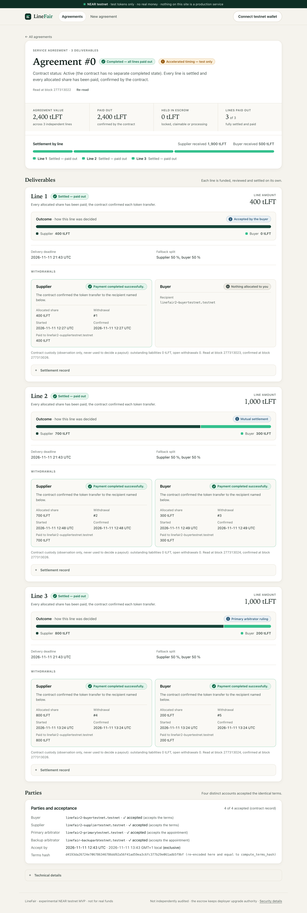

# LineFair

**Line-by-line escrow for multi-deliverable service agreements on NEAR.**
Pay for accepted work. Secure contested money. Resolve the difference under rules both parties agreed to in advance.

> [!WARNING]
> **Experimental NEAR testnet MVP. Not approved for production or real-money use.**
> - The deployed escrow **retains deployer upgrade authority**: the holder of its full-access key could change the contract or move funds it holds, so users must trust that key holder. See [Security](#security).
> - **No independent human security audit** has been completed. Automated testing, however extensive, is not an independent audit.

## Judge quickstart — do X, see Y

**Live read-only demo:** https://linefair-ebuskys-projects.vercel.app/#/agreements/0  
**Repository:** https://github.com/iamebuskycrypto/linefair  
**Network:** NEAR testnet only · experimental test tokens · no real-value use.

1. **Open the live agreement:** visit the demo link above. **See:** Agreement #0, three deliverables, and their line-by-line final outcomes. No wallet is required to read.
2. **Inspect the accepted line:** locate Line A. **See:** 400 tLFT settled to the supplier.
3. **Inspect the negotiated dispute:** locate Line B. **See:** the 1,000 tLFT line split 300/700 by mutual settlement.
4. **Inspect arbitration:** locate Line C. **See:** a 1,000 tLFT line split 200/800 by a primary-arbitrator ruling after the deadline transition.
5. **Verify accounting:** the three lines sum to 2,400 tLFT funded and 2,400 paid out; outstanding liabilities are zero. Compare the testnet transaction links below.
6. **Optional wallet check:** click **Connect testnet wallet**, choose Intear **Web**, and authenticate only with an account you control. **See:** the connected account in the header, then **Disconnect**. Connecting alone does not request transaction signatures. **Do not approve any payment or transaction for judging.**

The chain demonstration above completed through signed testnet transactions. The current public UI's separate wallet connect/disconnect acceptance passed; **its own transaction-submission flow has not been end-to-end acceptance-tested via the frontend**, so the judge quickstart intentionally requires no signing or funding. The escrow still has deployer upgrade authority and has not been independently audited. See [Security](#security) and [Known limitations](#known-limitations).

## The problem

A service order often contains several separately priced deliverables. In a single-escrow model, a dispute over one deliverable freezes payment for all of them. LineFair gives each line its own ledger and settlement path, so accepted work is paid while only the contested amount waits on a bounded, pre-agreed procedure.

## What was demonstrated on NEAR testnet

Agreement #0 on `escrow2.ebusky-linefair.testnet` was executed end to end with real Intear wallet signatures (22 signed transactions by buyer, supplier and both arbitrators). Every step below was then re-verified from chain state.

| Scenario | Outcome | Key transactions (testnet explorer) |
|---|---|---|
| Setup | Escrow deployed and initialised | [`9NkZkkCi…`](https://testnet.nearblocks.io/txns/9NkZkkCijvykcgocbY3H5D5of5ymHeF4vXxKiwNM7JmQ) |
| Agreement | Buyer creates immutable 3-line terms (400 / 1,000 / 1,000 tLFT). The contract recomputes the canonical terms hash. Four distinct roles accept → AGREED. Three exact NEP-141 fundings → custody 2,400. | create [`3qLjdULP…`](https://testnet.nearblocks.io/txns/3qLjdULPdSJt99gdvt3eZAvJQ9azBH2XrmR3bGgdwTXz) · funding [`DUogjQcK…`](https://testnet.nearblocks.io/txns/DUogjQcKSmwBZdnRL5AZcq2em9Z3tfdxSnx58DgxHT8T), [`DbFwHtrs…`](https://testnet.nearblocks.io/txns/DbFwHtrs827gpGjYWp7fsKVXCNrwmCFofbXp2fYrmna2), [`221jqmzY…`](https://testnet.nearblocks.io/txns/221jqmzYwLD9G8nt529B756ConmPZwhcS6W9354GgJXo) |
| **Line A: accepted** | Delivered, buyer accepts, supplier paid 400 | accept [`A9yrPdJs…`](https://testnet.nearblocks.io/txns/A9yrPdJs7sEaeDNBXev6yg3vfJsxo78dePKotnUB3zyf) · withdraw #1 [`Cus2jjk5…`](https://testnet.nearblocks.io/txns/Cus2jjk5LwKqLK5PPtnFXhW1wHPDFi1aYG8zQiLjXxPa) |
| **Line B: disputed, mutual settlement** | Buyer disputes and proposes 300 / 700; supplier accepts; both paid | dispute [`DvyMqz6r…`](https://testnet.nearblocks.io/txns/DvyMqz6rbaTr1v5PrFrfV915w5zbaCg534Y6pMB348yE) · propose [`HMyzPbx9…`](https://testnet.nearblocks.io/txns/HMyzPbx9718UE3y3TcPAAC47XcZCKMNiekYDj92Cs3ar) · accept [`6Hz2WKUe…`](https://testnet.nearblocks.io/txns/6Hz2WKUeSsSJDtDiYUDncEWrbkGcPMjqtjqs2uc5noVZ) · withdraw #2 [`Hq6AMQVQ…`](https://testnet.nearblocks.io/txns/Hq6AMQVQWKm8ZXk4yLJbBE5S1onZwDBwSDaYh1bwjDNU), #3 [`9UQAyb2z…`](https://testnet.nearblocks.io/txns/9UQAyb2zohCrWkWUXuLVaSqjQU5RoAVuDWpaSccncmYV) |
| **Line C: buyer silent, primary arbitration** | Permissionless `advance_case` fixes T0 at the review deadline. The primary arbitrator rules 200 / 800 inside its window; both paid. | advance [`7GV2eErY…`](https://testnet.nearblocks.io/txns/7GV2eErYTE76X549QmSNriDgnKoq9XN2EL7LiLo7stqx) · ruling [`FrcTdUtw…`](https://testnet.nearblocks.io/txns/FrcTdUtwCxzsWGVFupYDba6b8jjVajCtSQLGCvM3dXqt) · withdraw #4 [`A3oNRmqD…`](https://testnet.nearblocks.io/txns/A3oNRmqDZskQsUTLNeRHb4hv6TzWNRKsNuytkMPGwM8X), #5 [`EVayz4s4…`](https://testnet.nearblocks.io/txns/EVayz4s4vkEJ3G36AcfJUGydP9paC4xmdAvBFZoFY1Vz) |
| Final state | Outstanding liabilities 0, open withdrawals 0, escrow tLFT balance 0. Paid out 2,400 = funded 2,400; each withdrawal PAID exactly once. | `evidence/testnet/FINAL-ACCOUNTING-AUDIT-*.log.txt`, `FINAL-WITHDRAWALS-AUDIT-*.log.txt` |

The agreement used accelerated 10-minute windows, a test-only configuration labelled in the app; business defaults are 72 h / 48 h / 72 h / 72 h.

**Verified only in the local sandbox and tests, not on testnet:** backup-arbitrator ruling, deterministic fallback split, failed-withdrawal restoration, inconclusive-transfer handling (stays pending, no blind retry), and the late-funding refund guard.



## Run the read-only app locally

Requirements: Node.js and npm. No wallet is needed to read.

```sh
cd apps/web
npm ci --ignore-scripts
cp .env.example .env
# set in .env:
#   VITE_NEAR_RPC_URL=https://rpc.testnet.fastnear.com
#   VITE_ESCROW_ID=escrow2.ebusky-linefair.testnet
#   VITE_FT_ID=demo-ft.ebusky-linefair.testnet
npm run dev:local
```

Open `http://127.0.0.1:5173/#/agreements/0`. Each line reads "Settled — paid out", and every payout appears as "Payment completed successfully." with its withdrawal number. The app fails closed if the contract code hash, version or configuration does not match.

## Architecture

- **Escrow contract**: `contracts/escrow`, Rust, near-sdk 5.29.1.
  - Immutable per-agreement terms with an on-chain canonical hash; buyer and supplier accept identical terms.
  - Four distinct appointed accounts: buyer, supplier, primary arbitrator, backup arbitrator.
  - Per-line ledgers (locked / claimable / pending / paid) with checked `u128` arithmetic.
  - NEP-141 `ft_on_transfer` funding with strict token-caller and message checks; invalid deposits are refunded.
  - Phase-bounded disputes: negotiation → primary → backup → deterministic fallback.
  - Withdrawals move claimable → pending before an async `ft_transfer`. Only an authenticated private callback marks a payout PAID; an inconclusive result stays pending.
  - No admin withdrawal and no operator discretion; arbitrators can allocate only between the original buyer and supplier.
- **Frontend**: `apps/web`, React 19 + Vite, no backend.
  - Reads contract views directly and signs through `@near-wallet-selector` + Intear.
  - Integer-exact amounts and a fail-closed startup gate.
  - A payment is shown as PAID only after the contract records it.
- **Shared encoder**: `packages/shared-schemas`, a TypeScript canonical-terms encoder checked against the Rust test vectors.
- **Test token**: `contracts/test-ft`, the unmodified official near-sdk-rs fungible-token example (MIT, see its `LICENSE-MIT`).
- **Deployment tooling**: `deploy/`, a fail-closed testnet preflight.

Design and specification: `docs/04` (user journeys and UX copy), `docs/05` (architecture), `docs/06` (states and permissions), `docs/07` (escrow accounting and token flow), `docs/08` (disputes and time windows), `docs/10` (threat model), `docs/20` (data models and events), `docs/21` (toolchain lock), `docs/25` (NEAR storage and gas budget), `docs/27` (withdrawal recovery design), `docs/28` (creator allowlist), `docs/29` (end-to-end test plan), `docs/31` (late-funding guard), `tests/FINANCIAL_INVARIANTS.md`.

## Tests

- **Frontend** (fresh clean install of this tree, 2026-11-11): typecheck pass, 144/144 tests, production build pass, bundle key-material scan 0 hits. **Additional wallet/frontend QA (2026-11-12):** 182/182 web unit tests, 5/5 bundle-leak tests, 45/45 browser checks at 390px and 1440px; founder-confirmed 7/7 real-wallet preview acceptance and production connect/disconnect. See `docs/qa/WALLET_UAT_FINAL_REPORT.md`. Browser checks include simulated wallet sessions and are not proof of frontend transaction-signing flows.
- **Shared encoder** (fresh clean install, 2026-11-11): typecheck pass, 25/25 tests, including the shared Rust vectors.
- **Contract** (fresh offline run on this tree, 2026-11-11T19:11Z): `cargo test --locked --offline --no-fail-fast` — **317 passed, 0 failed, 1 ignored** (opt-in gas-measurement probe), exit 0. That covers unit, model-based property, vector and near-sandbox tests against the genuine pinned token.
  - Before the run, the tree rebuilt the qualified release WASM (sha256 `470db97b…f2e1`, code hash `5nN5ua65…`, equal to the deployed contract).
  - The test token rebuilt to its pinned sha256 `c26d0ac1…b78d`.
  - An earlier run's log is in `evidence/tests/`.

```sh
# contract: toolchain pinned in rust-toolchain.toml (Rust 1.95.0, cargo-near 0.22.0, near-sandbox 2.13.4; see docs/21)
# 1. build the pinned test token used by the sandbox tests
(cd contracts/test-ft && cargo near build non-reproducible-wasm --locked)
# 2. build the escrow release + test-only artifacts and verify the qualified release hash
EXPECT_RELEASE_SHA256=470db97b62cd04701e68f6a87d7589dd8af9b8d122b96e4f5e12788d4405f2e1 contracts/escrow/scripts/build-artifacts.sh
# 3. run all contract tests (set NEAR_SANDBOX_BIN_PATH to the pinned near-sandbox binary)
cd contracts/escrow && cargo test --locked
# frontend
cd apps/web && npm ci --ignore-scripts && npm run typecheck && npm test && npm run build
# shared encoder
cd packages/shared-schemas && npm ci --ignore-scripts && npm test
```

## Security

Full details are in [`SECURITY.md`](SECURITY.md).

- **Experimental, testnet only.** LineFair is a hackathon MVP running on NEAR testnet with a valueless test token. It is not approved for production or real-money use.
- **Deployer upgrade authority.** The escrow account `escrow2.ebusky-linefair.testnet` still holds its deployer full-access key (one FullAccess key at testnet block 277228964).
  - The contract code contains no admin withdrawal and no operator discretion, but the key holder is not bound by that code. The key holder can deploy different code, sign token transfers as the escrow account, or delete the account.
  - "Immutable terms" therefore means that contract methods cannot change an agreement. It does not mean that the deployment cannot be upgraded, so users must trust the key holder.
  - The demo agreement is fully settled, and the escrow held 0 tLFT at block 277228982.
  - Before any real-value use, upgrade authority would need to be removed or placed under transparent, audited governance.
- **No independent audit.** All reviews were AI-assisted. The automated tests, property tests, adversarial tests and live accounting audit described below are not a substitute for an independent human security audit.

## Known limitations

- Several behaviours were verified only in the sandbox, not on testnet (listed above).
- There is no recovery path for a withdrawal whose transfer outcome is inconclusive; it stays frozen as pending.
- The app depends on a public testnet RPC; it fails closed on read errors and does not retry.
- No token-balance display in the app.
- Evidence documents stay off-chain; only salted commitments go on chain. The evidence storage API was not implemented.

## Hackathon disclosures

- **Built at the NEAR Hackathon.** All work falls inside the official hackathon window, which opened on 2026-10-19:
  - 2026-10-27: specification and planning; no product code.
  - 2026-11-01: first product code (escrow contract skeleton).
  - 2026-11-11: tested MVP frozen. This repository's content corresponds to that frozen source.
- **Repository history:** this public repository is a single sanitized export of the tested MVP. The private development history (162 commits) is not published because it contains local machine paths. The whole repository is therefore the hackathon work, NEAR integration included; see the [commit history](https://github.com/iamebuskycrypto/linefair/commits/main).
- **AI assistance:** the implementation was written with Claude Code (Anthropic) under the founder's direction and review.
- **Libraries:** near-sdk, near-contract-standards, near-workspaces (Rust); React 19, Vite, @near-wallet-selector 10.1.4 (core, intear-wallet, my-near-wallet), buffer (TypeScript). Exact pins in `docs/21_TOOLCHAIN_LOCK.md` and the lockfiles. The test token is the official near-sdk-rs FT example.
- **Pre-existing material:** none beyond the project's own specification written in the hackathon window.

## License

MIT — see `LICENSE`. Third-party components keep their own licences.
